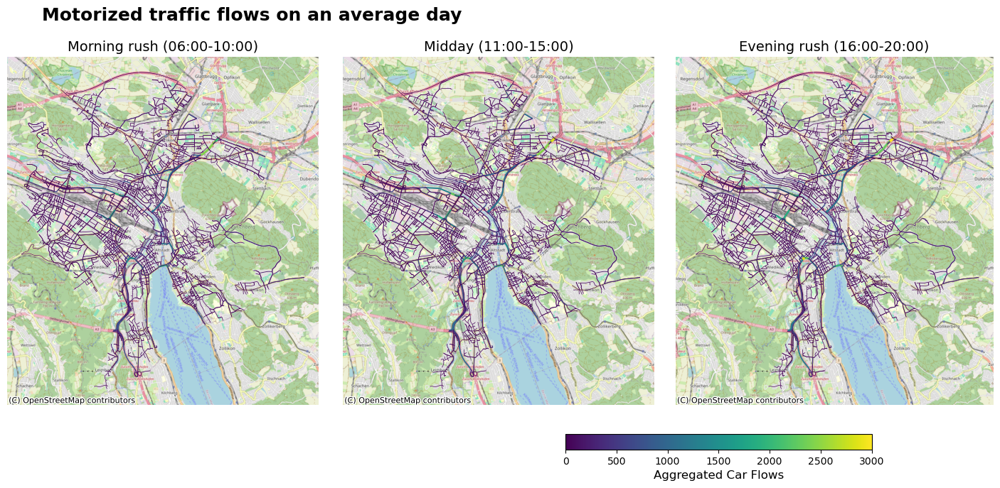
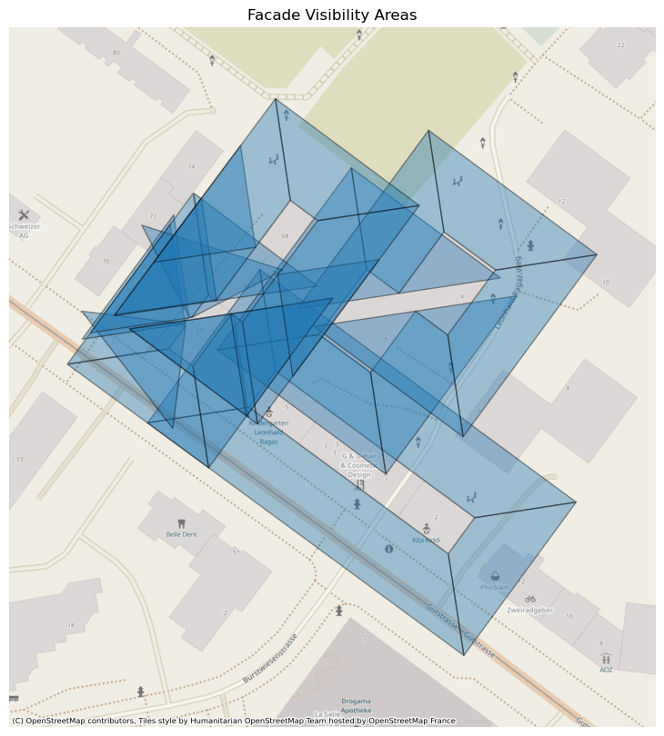

# FacADe

A city-scale data lake and data warehouse on AWS that estimates how often every building facade in Zürich is seen by cars, pedestrians, cyclists and public transport passengers, and turns that exposure into advertising impressions and revenue estimates.



## My contribution
Team project with Marcel Amrein and Fadri Campell (HSLU, Data Lake & Data Warehouse module, autumn 2025). I developed the flow models for motorized traffic, public transport and bike/pedestrian movement, which Fadri containerized and integrated into the AWS pipeline. I also led the storage side (PostGIS data warehouse design, the Glue/JDBC loader from the Gold layer, Google Street View ingestion) and built both Tableau dashboards ([impressions](https://public.tableau.com/app/profile/leonard.dost/viz/FacADeDashbaord/FacADeDashboard), [revenue](https://public.tableau.com/app/profile/leonard.dost/viz/FacADeRevenueDashbaord/FacADeRevenueDashboard)).

## Problem
Facade advertising is priced on location and gut feeling: there is no city-wide, data-based measure of how many people actually pass a given facade. Marketing agencies want to find the facades with the most exposure for a target audience; property owners want to know whether their facades could earn advertising revenue. FacADe estimates facade-level exposure for all of Zürich from open mobility data and serves it to both groups.

## Data
All inputs are open government data from the City of Zürich and opendata.swiss:

| Dataset | Content | Update | Access |
|---|---|---|---|
| Facade geometries | 2D facade geometries for all buildings in Zürich (from the "solar suitability of facades" dataset) | irregular | GeoPackage download |
| Motorized traffic counts | hourly vehicle counts from measurement stations | daily | CKAN API |
| Pedestrian and bicycle counts | hourly counts from fixed counters | daily | CKAN API |
| VBZ passenger volumes | passengers per line segment and day type | monthly | file download |

Raw and modelled data are not part of this repository; the ingestion functions in `AWS/Lambda/` fetch them from the source APIs.

## Approach
- **Medallion data lake on S3:** Bronze (raw, unchanged), Silver (normalized: consistent columns, timestamps, Swiss coordinate system EPSG:2056) and Gold (model outputs), stored as partitioned Parquet/GeoParquet.
- **Ingestion:** AWS Lambda functions triggered weekly by EventBridge pull new data from the Zürich OGD APIs, with a DynamoDB audit table for ingestion runs.
- **Geospatial models on ECS Fargate:** four containerized models, orchestrated in parallel by AWS Step Functions:
  - *Facade visibility:* a visibility polygon in front of every facade (default 30 m, ±45°).
  - *Motorized traffic, bike/pedestrian and public transport flows:* sparse counting-station measurements are propagated onto the OpenStreetMap street, path and transit networks with distance decay and directional weighting, aggregated into typical-day profiles per hour.
- **Data warehouse:** PostgreSQL/PostGIS on RDS, loaded from the Gold layer with an AWS Glue JDBC job; spatial joins between flows and visibility polygons are precomputed in materialized views with GIST indexes.
- **Visualization:** two Tableau Public dashboards on the warehouse, one for marketing agencies (impressions by facade, mode and time of day, with Street View imagery) and one for property owners (revenue estimates from a configurable cost-per-mille).

```
Zürich OGD APIs → Lambda → S3 Bronze → Silver → ECS models → S3 Gold → Glue → PostGIS → Tableau
```

## Results
- End-to-end pipeline from open data to facade-level exposure for the whole city, running on AWS with weekly ingestion and parallel model execution.
- Motorized traffic modelled on 6,253 street segments, with typical-day flows up to about 9,450 vehicles per segment; separate flow layers for bikes/pedestrians and VBZ public transport.
- Two interactive dashboards: [Facade Impressions](https://public.tableau.com/app/profile/leonard.dost/viz/FacADeDashbaord/FacADeDashboard) for agencies and [Facade Revenue](https://public.tableau.com/app/profile/leonard.dost/viz/FacADeRevenueDashbaord/FacADeRevenueDashboard) for property owners.
- Full documentation in the [project report](docs/facADe_Project_Report.pdf).



## How to run
The full pipeline runs on AWS and needs an AWS account; the [project report](docs/facADe_Project_Report.pdf) describes the setup. Main steps:

1. Create the S3 buckets for the Bronze, Silver and Gold layers.
2. Deploy the ingestion functions in `AWS/Lambda/` and schedule them with EventBridge.
3. Build the model images in `AWS/containers/*/` with Docker, push them to Amazon ECR and run them on ECS Fargate via the Step Functions definition in `AWS/step-functions/`.
4. Create the warehouse schema from `AWS/production_schema.sql` on an RDS PostgreSQL instance with PostGIS and load the Gold layer with `AWS/glue_loader_jdbc.py`.

The models can also run locally with Docker: each container folder has a `run_locally.sh` that mounts `AWS/containers/local_bucket/` as the data root. Place the input data there first; it is not included in the repository.

The notebooks in `notebooks/` plot the model outputs and read them from `AWS/containers/local_bucket/gold/`; the saved outputs show the results without re-running.

```bash
git clone https://github.com/ledostxx/facADe.git
cd facADe
```

## Repository structure
```
├── AWS/
│   ├── Lambda/                  # ingestion functions (traffic, pedestrian/bike, VBZ)
│   ├── containers/              # facade visibility and flow models (Docker, ECS Fargate)
│   │   ├── facade/
│   │   ├── traffic-flows/
│   │   ├── bike-peds-flows/
│   │   └── vbz-flows/
│   ├── step-functions/          # orchestration of the parallel model runs
│   ├── glue_loader_jdbc.py      # Gold layer → PostGIS warehouse
│   └── production_schema.sql    # warehouse schema, materialized views, spatial indexes
├── notebooks/                   # plots of the model outputs
└── docs/                        # project report and figures
```

## Limitations & next steps
- Zürich has far fewer pedestrian and bicycle counting stations than traffic sensors, so slow-mobility flows are sparse and uncertain in large parts of the city. This matters most for the business case, since pedestrian exposure is usually the most valuable for facade advertising.
- Flow propagation relies on simplifying assumptions about movement, direction and distance decay, and on the completeness of the OpenStreetMap network; the flows are estimates, not ground truth.
- Revenue figures depend on an assumed cost-per-mille rather than observed prices.
- Next steps: Monte Carlo propagation to quantify uncertainty in the flows, computer vision on street-level imagery to estimate the usable advertising area per facade, and calibrating prices with real campaign data.
